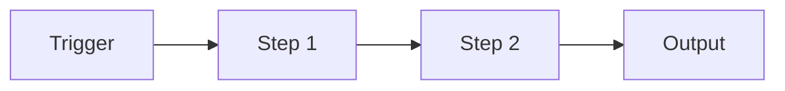

# {{title}}

<One sentence: when to run it and what you get.>

## At a glance

- Trigger: <event, schedule or request>.
- Owner: <role>. Takes about <duration>.
- Output: <artifact>, delivered to <who or where>.

## Before you start

- [ ] <Access, tool or input needed>

## Steps

1. <One action per step, with what you see when it worked.> ^step-1
2. <Next action.> ^step-2
3. <Check the result.> ^step-3

## Troubleshooting

| Symptom | Cause | Fix |
|---|---|---|
| <what you see> | <why> | <what to do> |

## Related

- [[<Hub or MOC>]]
- [[<Concept it relies on>]]
- [[<Runbook for when it fails>]]

## Changelog

- {{date}} <who>: note created from the process template.
